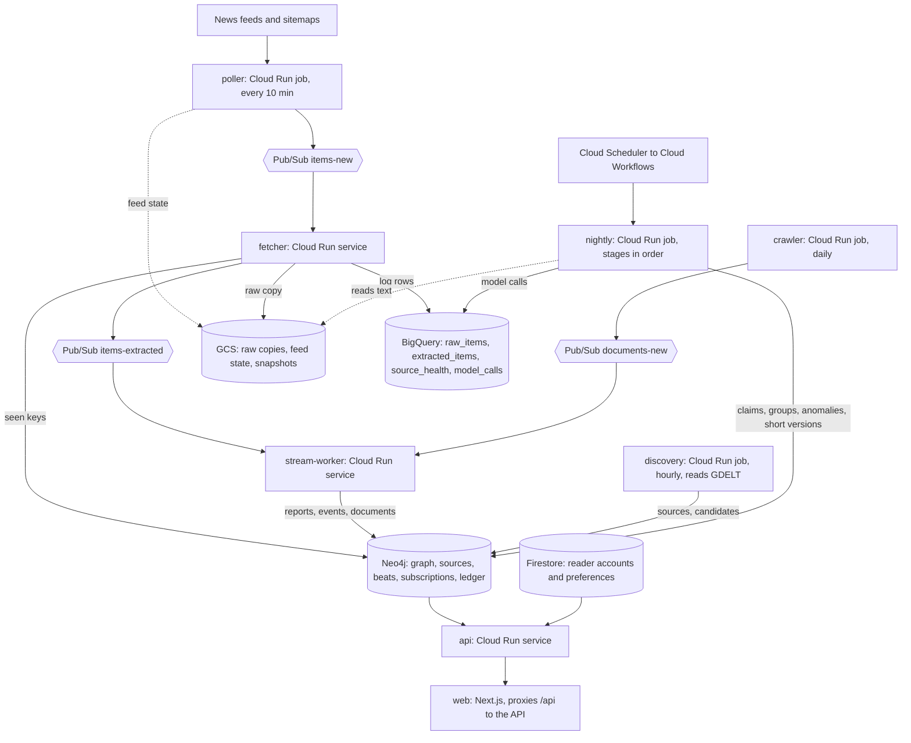

# Architecture

How data moves through the system as built today. The spec (`docs/spec.md`) is the longer description and also lists what is planned; where the two differ, this page matches the code. Decisions are in `docs/decisions.md`.

## Steps, and what each reads and writes

| Step | Reads | Writes |
| --- | --- | --- |
| discovery (hourly) | GDELT files, Neo4j (beats, known domains), each candidate's homepage and feeds | `Source` and candidate nodes |
| poller (10 min) | active `Source` nodes, feeds and sitemaps, feed state in GCS | `items-new` messages, feed state, `source_health` rows |
| fetcher | `items-new`, the article URL, `Seen` nodes | raw copy in GCS, `raw_items` and `extracted_items` rows, `Seen` nodes, `items-extracted` |
| stream-worker | `items-extracted`, `documents-new`, beats and open events in Neo4j | `Report`, `Event`, `Story`, `Document`, entity and copy nodes |
| crawler (daily) | portal pages | raw copy, `documents-new` |
| nightly stages | reports, events and raw text, the model | claims, claim groups, conflicts, anomalies (rules engine, no model), short versions, summaries, `BatchRun` nodes, `model_calls` rows |
| api | Neo4j, Firestore | nothing, except subscriptions, reader reports and the admin toggles |
| web | the API | nothing |

## Rules that shape the flow
- Anomalies come from `pipeline/anomalies` and `config/rules.yaml` only. Models supply inputs (claims, groups, entities).
- Every model call goes through `weft_core/models.py` (pinned, logged, capped by the daily ledger).
- A story is private (404) until the admin publishes it.
- Raw copies live 30 days in GCS; Neo4j keeps summaries and links.

## Not built (D24)
Apache Beam on Dataflow and Memorystore Redis. The live story stream polls the graph.
