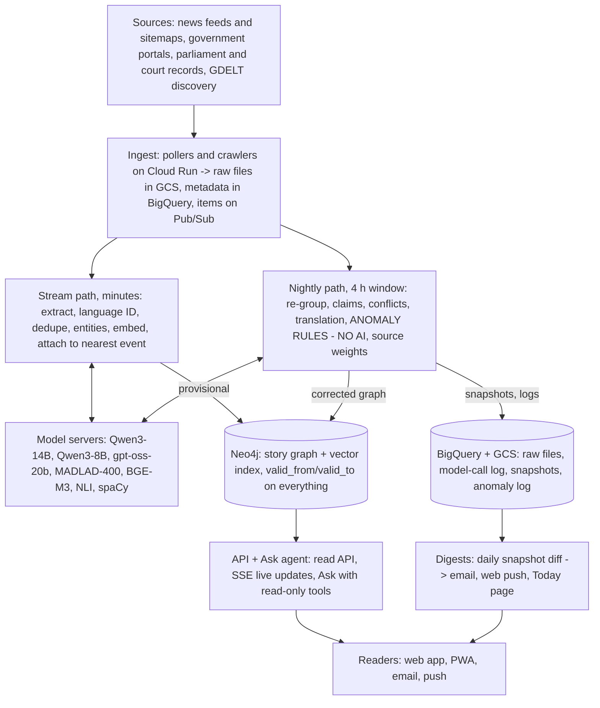

# Weft — Technical Specification

As of Nov 5, 2026 · Mihir Srivastava · Living copy: https://claude.ai/artifact/WccG41L7xW7xpVRKEaYpcd

## Overview and principles

Weft collects news reports, official documents and public proceedings from every country involved in a story. It groups them into a story graph and flags anomalies where reports don't line up. This spec covers the MVP build on Google Cloud, using open-weight models from Hugging Face.

Six principles constrain every choice below:

1. **Weft never claims what is true.** It reports who said what, when and from where. No label, status or score asserts truth.
2. **Anomalies come from written rules, never from an AI model.** Each anomaly links to its rule, its rule version and its evidence.
3. **Models only read, translate, check merges and answer questions.** Every model output links back to the source sentence it came from.
4. **Every model call is reproducible.** Pinned model revision, temperature 0, fixed seed, input and output logged.
5. **Store summaries and links, not full articles.** Raw copies are kept privately and only for processing.
6. **Weight changes ordering only.** No report is ever hidden.

## Scope

The MVP covers 1–2 beats in 3–5 languages, on nightly batch plus 15-minute ingest. Live screens, the Ask agent and subscriptions come in v2.

| Area | MVP | v2 | Later |
| --- | --- | --- | --- |
| Beats and languages | 1–2 beats, 3–5 languages | 5–10 beats, 10+ languages | Open-ended coverage |
| Sources | News RSS and sitemaps, government portals, parliament transcripts | Court records, captions of proceeding videos | Reader-suggested sources, reviewed by editors |
| Screens | Story view (network and list), event page, source profile, proceeding page, Today, All stories, How we weigh, onboarding | Live view, World desk, person page, Ask Weft | Native mobile apps |
| Anomaly rules | Omission, numbers differ, silence, copied text, silent edit | Loaded wording, unattributed | Rules proposed by readers, reviewed in public |
| Models | Claim extraction, merge check, translation | Ask agent, digests | — |
| Accounts | Free accounts, follows, email digest | Subscriptions, push notifications | Team and newsroom accounts |

## Architecture overview



Stream workers attach new items within minutes. The nightly run corrects the day's grouping and is the only place anomalies and source weights are computed.

## Data sources and ingestion

Ingestion polls feeds and sitemaps every 5–15 minutes and crawls official portals daily. GDELT serves as a discovery feed, not a source of record.

### Source registry

Every source lives in a reviewed `config/sources/*.yaml` file in git, synced to `Source` nodes in Neo4j. A git history of who added or relabelled a source is part of the trust story.

| Field | Example | Notes |
| --- | --- | --- |
| `id`, `name`, `homepage` | `aldor-herald` | Stable slug |
| `country`, `languages` | `AL`, `[al]` | ISO 3166 and ISO 639 |
| `type` | `news`, `wire`, `blog`, `gov`, `parliament`, `court`, `intl_body` | Drives weighting and labels |
| `state_run`, `owner_id` | `false`, `owner-group-x` | From public filings, cited in the file |
| `feeds`, `sitemaps` | RSS/Atom URLs, news sitemap URLs | Polled |
| `crawl` | Start URLs, allow patterns, max depth | Only for portals without feeds |
| `rate_limit` | 1 request per 10 s | Per domain |
| `paywalled` | `true` | Metadata and lede only, never bypassed |

Whether a document's issuer is a **party** is decided per story: each `Story` lists its parties (countries, organisations), set by an editor. A ministry is a party to a story about its own country's conflict, and independent elsewhere.

### Ingestion methods

| Source kind | Method | Cadence | Tools |
| --- | --- | --- | --- |
| News feeds | Conditional GET (ETag, Last-Modified) | 5–15 min | Cloud Run job, `feedparser` |
| News sitemaps | Poll, diff URL set | 15 min | Cloud Run job |
| Article pages | Fetch on new URL, extract text and metadata | On arrival | `trafilatura`; Playwright for JS-only pages |
| Government portals, gazettes | Crawl start URLs, detect change by content hash | Daily | Cloud Run job, `pdfplumber`, Tesseract OCR for scans |
| Parliament and court records | Fetch published transcripts | Daily | Same as portals |
| Proceeding videos (v2) | Captions, else speech-to-text | Daily | Whisper (see Models) |
| GDELT discovery feed | Read the 15-minute GDELT 2.0 files or the BigQuery public dataset | 15 min | BigQuery scheduled query |
| Re-fetch for silent edits | Fetch again and diff extracted text | +1 h, +24 h, +7 days | Cloud Tasks |

### What we take from GDELT

GDELT has monitored world news in 100+ languages on a 15-minute cycle since 2015, and its terms allow commercial use with a citation and link back. Weft uses it for three things:

- **Discovery:** URLs GDELT saw in the last 15 minutes that aren't from a registered source become candidates for an editor to review. This is how the registry grows per country.
- **Coverage gaps:** comparing GDELT's mention counts by country with ours shows which countries we under-cover (feeds the World desk's gap panel).
- **Seeding events:** GDELT's events and entities are a weak signal when grouping reports. Never shown to readers as fact.

We don't use GDELT's tone scores or its event codes as labels. Both are machine-coded and noisy, and showing them would break principle 1. GDELT uses FIPS 10-4 country codes, so map them to ISO 3166 on read.

### Politeness and paywalls

- Obey robots.txt. One connection per domain, with the registry's minimum delay.
- User agent names Weft and a contact URL. Back off on 429 and honour `Retry-After`.
- Paywalled sources: headline, lede and metadata from the feed only. Omission rules skip them, since we can't see their full text.
- A source whose feed fails is marked unhealthy. Silence anomalies are suppressed for it until it recovers.

### Raw storage

Raw HTML, PDFs and captions go to `gs://weft-raw/{source}/{yyyy-mm-dd}/{sha256}`, with a 30-day lifecycle (legal review pending). Metadata goes to the BigQuery `raw_items` table. The dedupe key is canonical URL plus text hash.

Pub/Sub topics: `items.new`, `items.extracted`, `documents.new`, `graph.changed`.

## Processing pipeline

Two paths share one graph. The stream path attaches each new item within minutes (target p95 under 10 minutes from fetch). The nightly path re-does the day's grouping properly and runs everything that needs the whole day's data.

### Stream path (per item, Cloud Run workers on Pub/Sub)

| # | Stage | Input → output | Method |
| --- | --- | --- | --- |
| 1 | Extract | HTML → title, lede, body text, author, published time, section | `trafilatura`, schema.org metadata |
| 2 | Classify type | Metadata → news, op-ed or analysis | URL and `articleSection` rules; small-model fallback |
| 3 | Language ID | Text → language code | GlotLID |
| 4 | Near-duplicate | Text → duplicate or copy-candidate flag | MinHash LSH on 5-word shingles, Jaccard ≥ 0.8 (`datasketch`) |
| 5 | Entities | Text → people, places, organisations, linked to Wikidata IDs | spaCy or Stanza; GLiNER fallback for weak languages |
| 6 | Embed | Title + lede → 1024-dim vector | BGE-M3 |
| 7 | Attach to event | Vector + entities → event ID or new event | Top-20 nearest open events from the last 72 h; score = cosine + entity overlap + time proximity; above threshold = attach, else new event |
| 8 | Write | → `Report` node, provisional edges | Neo4j upsert; publish `graph.changed` |

### Nightly path (Dataflow + batch inference)

Runs in a 4-hour window. Each stage reads the previous stage's output table, so any stage can be re-run alone.

| # | Stage | Input → output | Method |
| --- | --- | --- | --- |
| 1 | Re-group | Last 14 days of reports → corrected events | Candidate pairs from vectors and entities; LLM merge check only on borderline pairs |
| 2 | Claim extraction | Report text → claims, each with source-sentence offsets | LLM with a forced JSON schema |
| 3 | Numbers and quotes | Text → figures with units, quoted speakers | Regex + dependency parse; no LLM |
| 4 | Claim groups | Claims in an event → groups of claims that say the same thing | Embedding clustering within the event |
| 5 | Conflict detection | Pairs of claim groups → contradicts or not | Multilingual NLI classifier |
| 6 | Short version | Claim groups → "reported by all", "reports conflict on", "no source has published" | Pure set logic over which perspectives carry each group |
| 7 | Translation | Summaries and claims for display → target language | MADLAD-400; long texts only when a reader opens them |
| 8 | Anomaly rules | Claim groups, coverage counts, edit diffs → anomalies | Rules engine (next section) |
| 9 | Source weights | Month of reports → one weight per source | Fixed formula over the six factors on How we weigh |
| 10 | Snapshot and diff | Graph → dated snapshot + change set | Export to GCS (Parquet); diff feeds Today and digests |
| 11 | Review sample | Random sample of merges, claims, translations → review queue | 1% per language, for editors |

Story summaries are extractive (TextRank over source sentences), so every summary sentence is a real sentence from a report.

## Anomaly rules engine

Seven deterministic rules compare reports with other reports. No model output decides whether an anomaly fires; models only supply the claim groups the rules count over.

| Rule | Fires when (default threshold) | Evidence shown to readers |
| --- | --- | --- |
| Omission | A claim group appears in ≥ 60% of an event's reports, and in none from one perspective | The claim group, the share of reports carrying it, the perspective's report list |
| Numbers differ | Same quantity (casualties, money, dates) differs by > 20% between reports of one event | Each figure with its source sentence |
| Silence | An outlet that covered a story publishes nothing on it for 48 h while the story's overall coverage stays within 50% of its prior 48 h | Outlet's coverage line vs the story's |
| Copied text | ≥ 3 outlets with different owners publish text with Jaccard ≥ 0.8 within 12 h, without crediting each other | Aligned passages, timestamps |
| Loaded wording | A term's weighted log-odds for one perspective vs the rest exceeds 3 ("Fightin' Words" method) | Term counts per perspective |
| Unattributed | A claim has no named source while ≥ 2 other reports of it name one | The claim, the attributed versions |
| Silent edit | Re-fetched text differs from the stored copy, with no correction note on the page | Side-by-side diff with times |

### Provisional state

An anomaly is shown as provisional until the event has ≥ 5 sources from ≥ 2 perspectives and 6 hours have passed since its first report. Provisional anomalies never trigger notifications.

### Suppression

- Unhealthy feeds: no silence anomaly for that source.
- Paywalled sources: excluded from omission and loaded-wording counts.
- Wire copy credited to the wire (e.g. "— Reuters"): not copied text.

### Versioning

Thresholds live in `config/rules.yaml` in git and are published on How we weigh. Each anomaly record stores the rule version, its inputs and its evidence IDs. Changing a threshold re-runs the rules nightly and logs every anomaly that appears or disappears.

The thresholds above are starting points to tune against an editor-labelled set before launch.

## Models and serving

Default to Qwen3 for generation (Apache 2.0, 100+ languages) and gpt-oss-20b for the Ask agent's tool calling. Everything fits on NVIDIA L4 (24 GB) GPUs at MVP scale. For the MVP, call these models through a hosted OpenAI-compatible API (decision D7); self-host when volume justifies it.

| Job | Hugging Face model | Hardware (self-hosted) | Licence | Notes |
| --- | --- | --- | --- | --- |
| Claim extraction | `Qwen/Qwen3-14B` (FP8) | 1× L4 | Apache 2.0 | Forced JSON output; each claim carries character offsets into the source |
| Merge check, type fallback, digests | `Qwen/Qwen3-8B` | 1× L4 | Apache 2.0 | Yes/no + reason for merges |
| Ask agent | `openai/gpt-oss-20b` | 1× L4 (about 16 GB) | Apache 2.0 + OpenAI usage policy | Tool calling; upgrade path `gpt-oss-120b` on 1× H100 80 GB |
| Translation | `google/madlad400-3b-mt` (7B for quality) | 1× L4 | Apache 2.0 | NLLB is excluded: non-commercial licence |
| Embeddings | `BAAI/bge-m3` | CPU or L4 | MIT | 1024-dim, multilingual, long input |
| Conflict detection (NLI) | `MoritzLaurer/mDeBERTa-v3-base-xnli-multilingual-nli-2mil7` | CPU | MIT | Classifier, not generative |
| Entities | spaCy pipelines; `urchade/gliner_multi-v2.1` fallback | CPU | MIT; Apache 2.0 | Linked to Wikidata |
| Language ID | `cis-lmu/glotlid` | CPU | Apache 2.0 | 1,000+ languages |
| Speech-to-text (v2) | `openai/whisper-large-v3` | 1× L4 | Check model card | Only for proceedings with no transcript |

Check every licence on its model card before launch, and benchmark on Weft's own labelled set before fixing a choice. Alternatives to evaluate: `google/gemma-3-12b-it` (140+ languages, Gemma terms) and `mistralai/Mistral-Small-3.1` (Apache 2.0).

### Serving (when self-hosted)

- **vLLM** with its OpenAI-compatible server, on GKE GPU node pools. Because hosted providers expose the same API, switching is an endpoint change.
- **Online pool:** on-demand L4s for stream workers and Ask, minimum 1, autoscaled on queue depth.
- **Batch pool:** spot L4s, scaled from 0 for the nightly window, using vLLM offline batch inference.
- **Pinning:** each model loaded at an exact Hugging Face commit hash, mirrored to a GCS bucket so deploys never depend on the Hub being up.
- **Settings:** temperature 0, fixed seed, guided JSON for structured jobs, max tokens per job type.

### Evaluation gate

A labelled set per language covers merges, claims, translations and NLI pairs. No model or prompt version ships unless it matches or beats the current one on that set. Results are logged in BigQuery `model_evals`.

## Data model

Neo4j holds the story graph and its vector indexes. BigQuery holds raw metadata, logs and analytics. GCS holds raw files and snapshots. User accounts sit in Firestore, apart from the story graph.

### Neo4j nodes

| Label | Key properties |
| --- | --- |
| `Story` | `id`, `title`, `beat`, `parties[]`, `status` (developing, quiet) |
| `Event` | `id`, `story_id`, `first_seen`, `centroid` (vector), `grouping_confidence` |
| `Report` | `id`, `url`, `source_id`, `published_at`, `type` (news, op-ed, analysis), `lang`, `summary`, `embedding`, `text_hash` |
| `Document` | `id`, `url`, `issuer_id`, `kind` (release, transcript, order, gazette), `published_at`, `lang` |
| `Claim` | `id`, `text`, `lang`, `source_span` (report or document ID + offsets), `embedding` |
| `ClaimGroup` | `id`, `event_id`, `label`, `perspectives[]` |
| `Source` | `id`, `name`, `country`, `type`, `state_run`, `weight`, `healthy` |
| `Owner` | `id`, `name`, `filing_url` |
| `Actor` | `id`, `name`, `wikidata_id`, `role` |
| `Perspective` | `id` (usually a country or bloc), `label` |
| `Anomaly` | `id`, `rule`, `rule_version`, `status` (provisional, active, withdrawn), `evidence_ids[]` |

### Relationships

```
(Report)-[:PUBLISHED_BY]->(Source)-[:OWNED_BY]->(Owner)
(Source)-[:VOICE_OF]->(Perspective)
(Report)-[:ABOUT]->(Event)-[:PART_OF]->(Story)
(Report|Document)-[:ASSERTS {offsets}]->(Claim)-[:IN_GROUP]->(ClaimGroup)
(ClaimGroup)-[:CONFLICTS_WITH {nli_score}]->(ClaimGroup)
(Document)-[:ISSUED_BY]->(Actor)
(Document)-[:RECORDS]->(Event)
(Actor)-[:SPOKE_AT {minute}]->(Document)
(Report)-[:COPIES {jaccard}]->(Report)
(Anomaly)-[:FLAGS]->(ClaimGroup|Source|Report)
```

Every node and relationship carries `valid_from` and `valid_to`. Nothing is deleted: a split or correction closes the old version and opens a new one, which is what makes Replay and the corrections log possible.

Vector indexes: `Report.embedding`, `Claim.embedding`, `Event.centroid` (1024-dim, cosine).

### BigQuery tables (partitioned by day, clustered by source)

| Table | Holds |
| --- | --- |
| `raw_items` | One row per fetched item: URL, source, fetch time, HTTP status, hashes, GCS path |
| `extracted_items` | Extraction output per item |
| `model_calls` | Every model call: job, model + commit hash, provider, prompt hash, input/output refs, latency, tokens |
| `anomalies_log` | Every anomaly fired, changed or withdrawn, with rule version |
| `source_scores_daily` | Weight and its six factors per source per day |
| `batch_runs` | Stage, run ID, start, end, row counts, status |
| `model_evals` | Evaluation results per model version |
| `gdelt_candidates` | URLs from GDELT not in the registry, for editor review |

### GCS

`weft-raw` (30-day lifecycle), `weft-snapshots` (daily graph exports, Parquet), `weft-models` (mirrored model weights).

## Backend services and API

All backend code is Python 3.12, so the pipeline, the models and the API share one language and one set of libraries. The API is FastAPI on Cloud Run.

| Service | Runtime | Responsibility |
| --- | --- | --- |
| `poller` | Cloud Run job, every 5–15 min | Feeds, sitemaps, GDELT read; publishes `items.new` |
| `crawler` | Cloud Run job, daily | Portals, transcripts, PDFs |
| `fetcher` | Cloud Run service on `items.new` | Fetch + extract; writes GCS and `raw_items` |
| `stream-worker` | Cloud Run service on `items.extracted` | Stream stages 2–8 |
| `nightly` | Dataflow Flex template + batch inference, orchestrated by Cloud Workflows | Nightly stages 1–11 |
| `api` | Cloud Run, FastAPI | Read API, live stream, accounts |
| `ask` | Cloud Run, FastAPI | Ask agent loop |
| `notifier` | Cloud Run on `graph.changed` | Digests, email, web push |
| `inference` | Hosted API (MVP) or GKE + vLLM | Model servers (Models section) |

### Read API (v1, JSON)

| Endpoint | Returns |
| --- | --- |
| `GET /v1/today` | Overnight changes, breaking stories, followed branches |
| `GET /v1/stories?region=&topic=&sort=` | Story index with coverage and anomaly counts |
| `GET /v1/stories/{id}?at=YYYY-MM-DD` | Story graph (nodes, edges, short version) as of a date, for Replay |
| `GET /v1/events/{id}` | One event, every perspective's telling |
| `GET /v1/nodes/{id}` | Any node with its evidence and source links |
| `GET /v1/sources/{id}` | Source profile, weight history, anomalies |
| `GET /v1/documents/{id}` | Document or proceeding page |
| `GET /v1/actors/{id}` | Person page |
| `GET /v1/world` | Coverage threads and gaps by country |
| `GET /v1/method` | Live rules, thresholds, weights formula, model versions, corrections log |
| `POST /v1/reports-problem` | Reader report on a grouping, translation or flag |

### Live updates

`GET /v1/stories/{id}/stream` is a server-sent events stream with `node.added`, `edge.added`, `anomaly.updated` and `event.merged` messages. `stream-worker` publishes to `graph.changed`; the API fans out through Memorystore (Redis) pub/sub to open connections.

### Ask agent

The agent gets read-only tools over a read-only Neo4j user:

- `search(query, story_id?)`: vector + keyword search, returns node IDs
- `get_node(id)`, `get_neighbors(id, types)`, `get_document(id)`, `get_source(id)`
- `run_template(name, params)`: about a dozen fixed Cypher queries. The agent never writes its own Cypher.

Guardrails:

- At most 8 tool calls per answer.
- Every sentence in the answer must cite at least one node; a post-check drops any sentence whose citation doesn't exist.
- The answer must attribute claims ("Veymari press reports…") and never state a verdict on truth.
- Scraped text reaches the model only as quoted data, never as instructions, to blunt prompt injection from articles.

### Accounts

Firebase Authentication. Follows, preferences and digest settings in Firestore. Payments arrive in v2 (provider is an open question).

## Frontend

Next.js (App Router) with React and TypeScript, deployed on Cloud Run behind Cloud CDN. Story and event pages render on the server so shared links load fast and are indexable; the graph is a client component on top.

| Screen | Route | Main API call | Design file |
| --- | --- | --- | --- |
| Today | `/` | `/v1/today` | `design/Today.dc.html` |
| All stories | `/stories` | `/v1/stories` | `design/Explore.dc.html` |
| Story view | `/s/{id}` (`?view=list`, `?at=` for Replay) | `/v1/stories/{id}` + live stream | `design/Main.dc.html` |
| Breaking story, live | `/s/{id}?live=1` | Same + live stream | `design/Live.dc.html` |
| One event, every telling | `/s/{id}/e/{eventId}` | `/v1/events/{id}` | `design/Event.dc.html` |
| Proceeding or document | `/d/{id}` | `/v1/documents/{id}` | `design/Proceeding.dc.html` |
| Source profile | `/sources/{id}` | `/v1/sources/{id}` | `design/Source.dc.html` |
| Person page | `/people/{id}` | `/v1/actors/{id}` | `design/Actor.dc.html` |
| World desk | `/world` | `/v1/world` | `design/World.dc.html` |
| Ask Weft | `/ask` | `ask` service | `design/Ask.dc.html` |
| How we weigh | `/method` | `/v1/method` | `design/Method.dc.html` |
| Onboarding | `/welcome` | Firestore preferences | `design/Onboard.dc.html` |
| Story view on phone | `/s/{id}` at phone width | Same as story view | `design/Mobile.dc.html` |

### Story graph rendering

- **Layout is computed, not physics-based:** x = day, the official-documents spine in the middle, one band per perspective above or below it. The same story always draws the same way, so Replay and screenshots stay stable.
- **SVG** with `d3-scale` and `d3-shape` up to about 300 nodes; above that, **Canvas** via PixiJS with the same layout code.
- **List view** uses the same data and is the default for screen readers.
- **Live mode:** `EventSource` on the stream endpoint; new nodes fade in. Motion is turned off under `prefers-reduced-motion`.

### Design system

Tokens taken from the design canvas: background `#060708`, text `#E8E6E1`, secondary `#8E939B`, body secondary `#B9BDC4`, party-document grey `#9A9FA7`, anomaly `#FF7A45`. Fonts: Instrument Serif for headings, Inter for body, IBM Plex Mono for labels. Dark theme first; a light theme is a later token swap.

### Mobile and accessibility

- Responsive web plus PWA: installable, with web push. The phone story view uses the vertical timeline from the canvas. Native apps come later.
- Text contrast at least 4.5:1, touch targets at least 44 px, every graph node reachable by keyboard.
- Translated text is always labelled, with a "Show original" toggle.
- Analytics: privacy-first, no ad trackers (tool is an open question).

## Infrastructure on GCP

Everything runs on Google Cloud, serverless where possible. GKE is used only for GPU model serving, once self-hosting starts.

| Concern | Service |
| --- | --- |
| Scheduling | Cloud Scheduler; Cloud Workflows for the nightly run |
| Queues | Pub/Sub; Cloud Tasks for delayed re-fetches |
| Stateless compute | Cloud Run services and jobs |
| Batch processing | Dataflow (Apache Beam, Python), Flex templates |
| Model serving | MVP: hosted OpenAI-compatible API. Later: GKE Standard, on-demand L4 pool for online jobs, spot L4 pool for batch |
| Graph database | Neo4j AuraDB on GCP (managed), private endpoint |
| Analytics and logs | BigQuery |
| Files | Cloud Storage |
| Cache and live fan-out | Memorystore for Redis |
| Accounts and preferences | Firebase Authentication, Firestore |
| Edge | External HTTPS load balancer, Cloud CDN, Cloud Armor (rate limits, bot rules) |
| Secrets | Secret Manager |
| Images | Artifact Registry |

### Environments and delivery

- Three GCP projects: `weft-dev`, `weft-staging`, `weft-prod`. Staging runs the nightly pipeline on a single beat.
- Infrastructure as code with Terraform; one module per concern.
- GitHub Actions builds images and pushes them to Artifact Registry. Merges to `main` deploy to staging, and a tag promotes to prod.
- Model and prompt changes go through the same pipeline and must pass the evaluation gate.

### Region

Pick the region by L4 and H100 availability first, then reader latency. Keep Neo4j, BigQuery and GKE in the same region to avoid egress cost and lag.

## Observability, audit and cost

Every anomaly, weight and model output must be traceable to its inputs. That audit trail is a product feature, not just ops hygiene.

### Targets (proposed)

| Measure | Target |
| --- | --- |
| Fetch to graph, stream path | p95 under 10 min |
| Nightly run | Done within 4 h |
| Story page API | p95 under 300 ms |
| Feed health | Unhealthy sources flagged within 1 h |

### Monitoring

- OpenTelemetry traces and metrics into Cloud Monitoring and Cloud Trace; logs in Cloud Logging, routed to BigQuery.
- Data-quality dashboards: items per source per hour, extraction failures, merge precision from the review sample, translation spot-check scores, anomalies fired and withdrawn per rule.
- Alerts: a feed silent for longer than its usual gap, a nightly stage over its time budget, inference queue depth, error rate.

### Audit trail

- `model_calls` stores model ID, commit hash, provider, prompt template version, input hash, output and latency for every call.
- `anomalies_log` stores rule version, inputs and evidence for every anomaly change.
- Daily graph snapshots let anyone rebuild what a page showed on a past date.

### Cost controls

- Token budget per beat per night, enforced by the orchestrator; stages degrade gracefully (fewer re-checks) rather than overspend.
- Embeddings cached by text hash; unchanged items are never re-embedded.
- Long-text translation only when a reader opens it.
- Batch APIs or spot GPUs for the nightly run; online capacity scales down overnight.
- BigQuery tables partitioned by day and clustered by source; billing budgets with alerts per project.

## Security, legal and compliance

The largest risks are legal (copyright, defamation, scraping terms), not technical. Get legal review before public launch.

| Risk | Mitigation |
| --- | --- |
| Copyright on articles | Show summaries, short quotes and links only; raw copies kept privately for 30 days for processing; legal review of the retention period |
| Scraping terms of service | Feeds and sitemaps first; obey robots.txt; honour opt-out requests within 48 h; never bypass paywalls |
| Defamation from anomaly labels | Labels describe reports, never people or truth; every flag shows its rule and evidence; a correction process with a public log |
| Prompt injection from scraped text | Scraped text passed to models as quoted data; agent tools read-only; no free-form Cypher; output post-checks |
| Reader data | India's DPDP Act 2023 and GDPR for EU readers: minimal data, consent for email and push, deletion on request |
| Private individuals in the news | Person pages only for public figures in their public role; others appear by role, not name |
| Account and API abuse | Cloud Armor rate limits, auth on write endpoints, App Check on the web app |
| Supply chain | Models pinned by commit hash; dependency scanning in CI; least-privilege service accounts |

GDELT data is used under its terms, with a citation and link on How we weigh.

## Milestones

Build one beat end to end before widening. Each phase has an exit check; durations are open until the team size is known. Task-level breakdown: `docs/backlog.md`.

1. **Foundations:** GCP projects, Terraform, source registry, pollers, raw storage, BigQuery tables. *Exit:* one beat's feeds ingesting reliably for a week.
2. **Nightly graph:** extraction, grouping, claim extraction, Neo4j writes, snapshots. *Exit:* editors rate merge and claim quality on a labelled sample, and it beats the agreed bar.
3. **Anomalies and core screens:** rules engine, source weights, story view, event page, source and proceeding pages, How we weigh. *Exit:* every anomaly on the beat checked by hand for a week, false flags logged.
4. **Private beta:** Today, onboarding, follows, email digest, report-a-problem, corrections log. *Exit:* outside readers use it weekly; feedback triaged.
5. **Live and Ask (v2):** stream path to the UI, live view, Ask agent, World desk, person page. *Exit:* Ask answers cite valid nodes 100% of the time on the eval set.
6. **Scale out:** more beats and languages, subscriptions, push, PWA polish.

## Open questions

- [ ] Which 1–2 beats and 3–5 languages launch first?
- [ ] Who are the editors who review sources, story parties and the 1% sample, and how many hours a week?
- [ ] Which GCP region, given L4 and H100 availability?
- [ ] Legal review: raw-copy retention period, quote length, jurisdictions for defamation.
- [ ] Size of the labelled evaluation set per language.
- [ ] Payments provider and pricing for subscriptions.
- [ ] Analytics tool that fits the no-ad-tracker rule.
- [ ] Neo4j AuraDB tier versus self-hosting, once graph size is known.
- [ ] Which hosted provider serves the open-weight models for the MVP.

## Sources

- [The Best Open Source and Open-Weight LLM Models to Run Locally in 2026](https://huggingface.co/blog/daya-shankar/open-source-llm-models-to-run-locally) (Hugging Face blog, May 2026): model sizes, licences, hardware tiers
- [GDELT: the quarter-billion-record open dataset](https://jwatte.com/blog/gdelt-open-data-kalev-leetaru/): GDELT cadence, coverage, terms and limits
- [GDELT GKG 2.0 BigQuery sample queries](https://blog.gdeltproject.org/google-bigquery-gkg-2-0-sample-queries/amp/)
